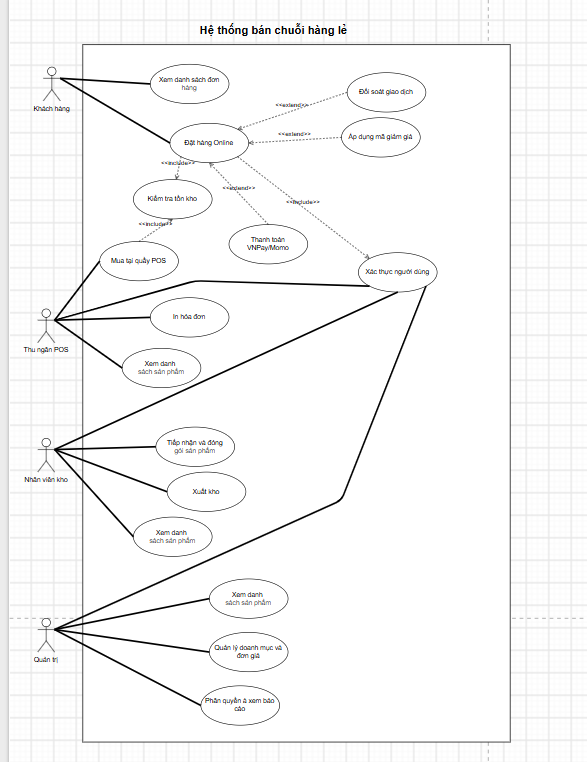
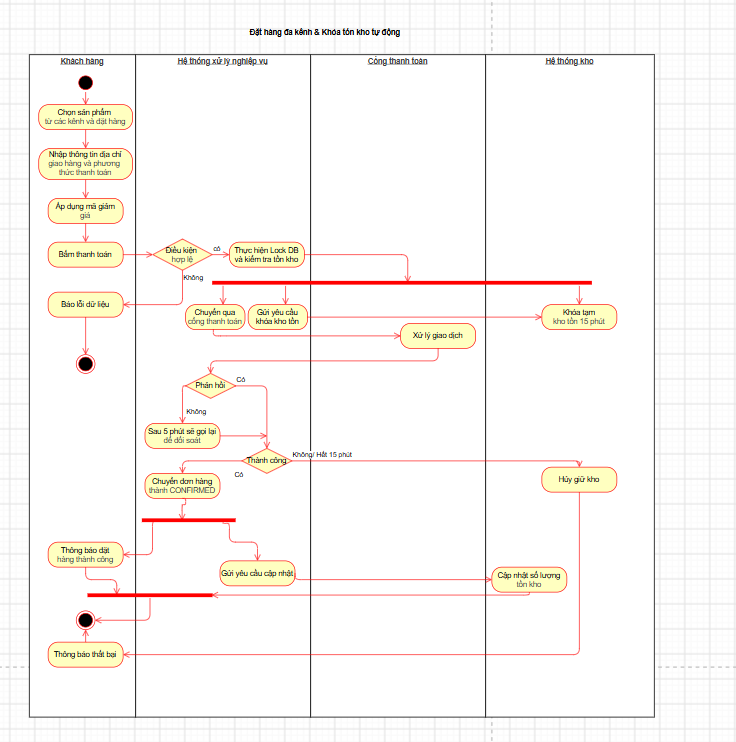
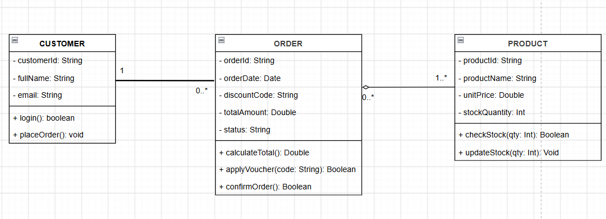
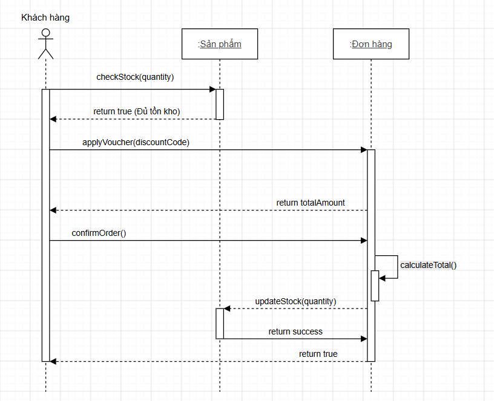
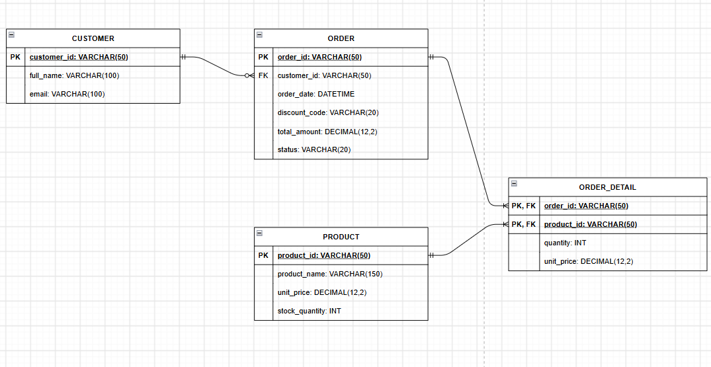

## Phần 1: Phân tích Bối cảnh:

+ Các Tầng xử lý:

  + Presentation Layer: Dùng để hiển thị giao diện cũng như hiển thị thông báo cho người dùng, Tương tác trực thếp với người dùng và thiết bị đầu cuối
  + Business Logic Layer: Sử lý đầu vào và logic bên trong đó, điều phối các API chuyển đến chức năng phù hợp với người dùng chọn chức năng nào, Quy tắc bán hàng và bảo mật
  + Data Access Layer: Tầng để truy vấn, cập nhật, xóa bản ghi trong dữ liệu được lưu trữ trong Server được an toàn và bảo mật nhất với dữ liệu người dùng
+ Lý do:

  + Ngăn chặn truy cập trực tiếp: Client sẽ không giao tiếp trực tiếp với CSDL mà qua tầng trung gian để giấu được cấu trúc bảng dữ liệu gốc
  + Phân rã tải mạng thông minh: Tầng Caching xử lý nhanh các request đọc lặp lại, giảm băng thông nghẽn mạng đến máy chủ CSDL chính
  + Dễ dàng mở rộng độc lập, có thể Scale-out riêng tầng Business hoặc Database khi lượng truy cập tăng vọt mà không sửa code giao diện
+ Các

Bảng Ma trận Nhu cầu tra cứu Hồ sơ SRS

| Nhóm Stakeholders                           | Nhu cầu / Mục đích tra cứu trong SRS                                                                 |
| -------------------------------------------- | --------------------------------------------------------------------------------------------------------- |
| **Ban Giám đốc FastMart**           | Xem mục tiêu kinh doanh, chi phí, tiến độ, báo cáo ROI và Yêu cầu phi chức năng (NFR).       |
| **PM Dự án**                         | Theo dõi WBS, phân bổ nguồn lực, quản lý phạm vi, rủi ro và Ma trận truy xuất yêu cầu.      |
| **Đội Lập trình Backend/Frontend** | Đọc Yêu cầu chức năng (FR), đặc tả API, sơ đồ cơ sở dữ liệu và ràng buộc kỹ thuật.   |
| **Đội Kiểm thử QA/Tester**         | Xác định tiêu chí nghiệm thu (Acceptance Criteria), kịch bản test và mức độ chịu tải (NFR). |

Phân loại Yêu cầu Chức năng (FR) và Phi chức năng (NFR)

* Yêu cầu Chức năng (FR):

  * FR1: Hệ thống cho phép khách hàng đăng ký, đăng nhập và quản lý tài khoản cá nhân
  * FR2: Hệ thống hỗ trợ tạo đơn hàng và trừ tồn kho tự động theo thời gian thực
  * FR3: Thu ngân có thể tính tiền, áp mã giảm giá và in hóa đơn qua POS Terminal
  * FR4: Quản lý kho có thể tra cứu lịch sử nhập/xuất và cảnh báo hàng sắp hết
* Yêu cầu Phi chức năng (NFR):

  * NFR1 (SLA Uptime): Hệ thống đạt độ sẵn sàng hoạt động tối thiểu 99.9% thời gian trong năm
  * NFR2 (Latency): Thời gian phản hồi API trung bình dưới 200ms cho các thao tác thông thường
  * NFR3 (Mã hóa dữ liệu): Dữ liệu truyền tải mã hóa SSL/TLS (Công nghệ bảo mật tiêu chuẩn giúp mã hóa toàn bộ dữ liệu) 1.3 và mật khẩu băm bằng bcrypt
  * NFR4 (Khả năng chịu tải): Hỗ trợ tối thiểu 5,000 phiên truy cập đồng thời mà không bị nghẽn mạng

  truyền qua lại giữa thiết bị

## Phần 2: Use Case Diagram

### Actors (4 Actor):

* Customer (Khách hàng): Người dùng đặt hàng trực tuyến qua Mobile App hoặc Website FastMart
* Cashier (Thu ngân POS): Nhân viên bán hàng trực tiếp tại 50 cửa hàng siêu thị, thao tác qua máy POS Terminals
* Warehouse Staff (Nhân viên kho): Quản lý xuất/nhập kho, điều chuyển hàng hóa và kiểm đếm tồn kho thực tế
* System Admin (Quản trị hệ thống): Quản lý cấu hình danh mục, mã giảm giá, phân quyền và giám sát dịch vụ đối soát tự động

### Danh sách Use Cases

+ UC - 01: Xác thực người dùng
+ UC - 02: Đặt hàng Online
+ UC - 03: Mua hàng tại quầy POS
+ UC - 04: Kiểm tra tồn kho thời gian thực
+ UC - 05: Áp mã giảm giá Voucher
+ UC - 06: Thanh toán qua cổng VNPay/Mômp
+ UC - 07: Cập nhật tồn kho
+ UC - 08: Đối soát giao dịch tự động

++ Vẽ UseCase

### Đặc tả Đặt hàng Online & Khóa tồn kho tự động

| **Thành phần** | **Nội dung Đặc tả**                                                                                                                                                                                                                                                                                                               |
| ---------------------- | ------------------------------------------------------------------------------------------------------------------------------------------------------------------------------------------------------------------------------------------------------------------------------------------------------------------------------------------- |
| Use Case ID & Name     | UC-02: Đặt hàng Online & Khóa tồn kho tự động                                                                                                                                                                                                                                                                                       |
| Primary Actor          | Customer (Khách hàng)                                                                                                                                                                                                                                                                                                                     |
| Secondary Actors       | Payment Gateway (VNPay/Momo), Warehouse System, Reconciliation Service                                                                                                                                                                                                                                                                      |
| Mô tả                | Khách hàng thực hiện chọn hàng từ giỏ, áp mã giảm giá (nếu có) và xác nhận đặt hàng. Hệ thống thực hiện kiểm tra tồn kho thời gian thực, tạm khóa kho trong 15 phút, gọi thanh toán qua cổng thanh toán và xử lý đối soát tự động nếu có gián đoạn kết nối.                              |
| Tiền điều kiện     | 1. Khách hàng đã đăng nhập thành công 2. Giỏ hàng có ít nhất 01 sản phẩm hợp lệ.                                                                                                                                                                                                                                     |
| Hậu điều kiện      | Khi thành công:-Trạng thái đơn hàng chuyển thành CONFIRMED.- Tồn kho thực tế bị trừ chính thức - Khách hàng nhận được thông báo đặt hàng thành công Khi thất bại:- Trạng thái đơn hàng chuyển thành CANCELLED - Khóa tạm thời (Hold Stock) được giải phóng về kho khả dụng |

### Luồng chính (Main Flow)

* Bước 1: Khách hàng kiểm tra lại giỏ hàng và bấm nút  "Đặt hàng"
* Bước 2: Tầng Nghiệp vụ (Business Layer) thực hiện kiểm tra dữ liệu đầu vào: validate số lượng tồn kho,  kiểm tra định dạng dữ liệu đầu vào chống SQL Injection / Parameter Tampering (Bẫy 3)
* Bước 3: Tầng Nghiệp vụ thực hiện cơ chế khóa DB (Pessimistic Locking hoặc Optimistic Versioning) để đọc chính xác số lượng tồn kho khả dụng, tránh xung đột dữ liệu đồng thời (Bẫy 1)
* Bước 4: Hệ thống khởi tạo đơn hàng ở trạng thái  PENDING_PAYMENT và tạo bản ghi Khóa tạm thời (Hold Stock) trong 15 phút tại Tầng Kho
* Bước 5: Hệ thống tạo URL thanh toán và chuyển Khách hàng sang Cổng thanh toán (VNPay/Momo)
* Bước 6 : Cổng thanh toán trả về phản hồi thành công trong vòng vài giây
* Bước 7: Tầng Nghiệp vụ chuyển trạng thái đơn hàng thành CONFIRMED, gửi lệnh chuyển Hold Stock thành trừ kho chính thức
* Bước 8: Hệ thống hiển thị thông báo đặt hàng thành công trên ứng dụng Khách hàng và kết thúc Use Case

## Phần 3: Activity Diagram

## Phần 4: Class

### Danh sách các Class được liệt kê

| **Class** | **Thuộc tính**                                                                                                | **Phương thức**                                                                            |
| --------------- | --------------------------------------------------------------------------------------------------------------------- | --------------------------------------------------------------------------------------------------- |
| Custumer        | - customerId: String - fullName: String - email: String                                                    | + login(): boolean + placeOrrder(): Void                                                       |
| Order           | - orderId: String - orderDate: Date - discountCode: String - totalAmount: Double - status: String | + calculateTotal(): double + applyVoucher(code: String): void + confirmOrder(): boolean |
| Product         | - productId: String - productName: String - unitPrice: double - stockQuantity: int                 | + checkStock(qty: int): boolean + updateStock(qty: int): void                                |

### Class Diagram: được vẽ trong drawio

+ Chọn quan hệ Aggregation giữa Order và Product vì Sản phẩm tồn tại hoàn toàn độc lập trong danh mục quản lý của siêu thị; ngay cả khi một Đơn hàng bị hủy hoặc xóa khỏi hệ thống, đối tượng Sản phẩm đó vẫn tồn tại và giữ nguyên thông tin trong CSDL.

## Phần 5: Sequence Diagram

## Phần 6: WireFrame

Link: [www.figma.com/design/cBfHWEdH8ZbnEsdKEiaPcr/MiniSession19?node-id=7-2&amp;t=v3YOG2yHkl54FrcA-1](https://www.figma.com/design/cBfHWEdH8ZbnEsdKEiaPcr/MiniSession19?node-id=7-2&t=v3YOG2yHkl54FrcA-1)

## Phần 7: ERD

| **Bảng (Entity)**                     | **Cột (Column) & Kiểu dữ liệu**                                                                                                                         | **Khóa (PK / FK)**                                                                                                                                                                          |
| -------------------------------------------- | ----------------------------------------------------------------------------------------------------------------------------------------------------------------- | -------------------------------------------------------------------------------------------------------------------------------------------------------------------------------------------------- |
| **Customer**                           | `customer_id`: VARCHAR(50)`full_name`: VARCHAR(100)`email`: VARCHAR(100)                                                                                    | **PK:** `customer_id`                                                                                                                                                                      |
| **Order**                              | `order_id`: VARCHAR(50)`customer_id`: VARCHAR(50)`order_date`: DATETIME`discount_code`: VARCHAR(20)`total_amount`: DECIMAL(12,2)`status`: VARCHAR(20) | **PK:** `order_id`**FK:** `customer_id` **$\rightarrow$** `Customer(customer_id)`                                                                                        |
| **Product**                            | `product_id`: VARCHAR(50)`product_name`: VARCHAR(150)`unit_price`: DECIMAL(12,2)`stock_quantity`: INT                                                     | **PK:** `product_id`                                                                                                                                                                       |
| **OrderDetail** *(Bảng trung gian)* | `order_id`: VARCHAR(50)`product_id`: VARCHAR(50)`quantity`: INT`unit_price`: DECIMAL(12,2)                                                                | **PK:**(`order_id`,`product_id`)**FK1:** `order_id` **$\rightarrow$** `Order(order_id)`**FK2:** `product_id` **$\rightarrow$** `Product(product_id)` |

## Phần 8: vị trí SRS

| **Sơ đồ** | **Vị trí trong SRS**              |
| ------------------ | ----------------------------------------- |
| Use Case Diagram   | 2.3 (User Classes)                        |
| UI Wireframe       | 3.1 (External Interface: UI/UX)           |
| ERD                | 3.4 (Database Requirements: Sơ đồ ERD) |
| Class Diagram      | Phụ lục                                 |
